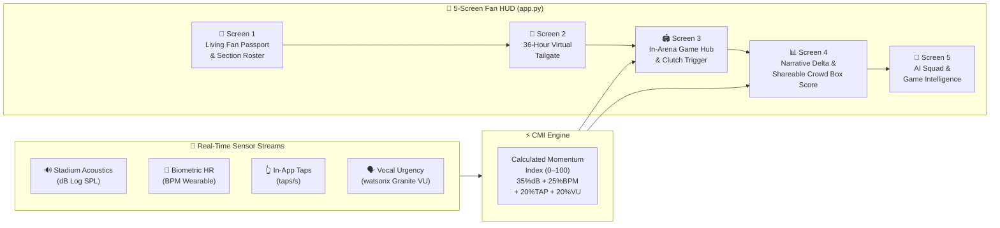
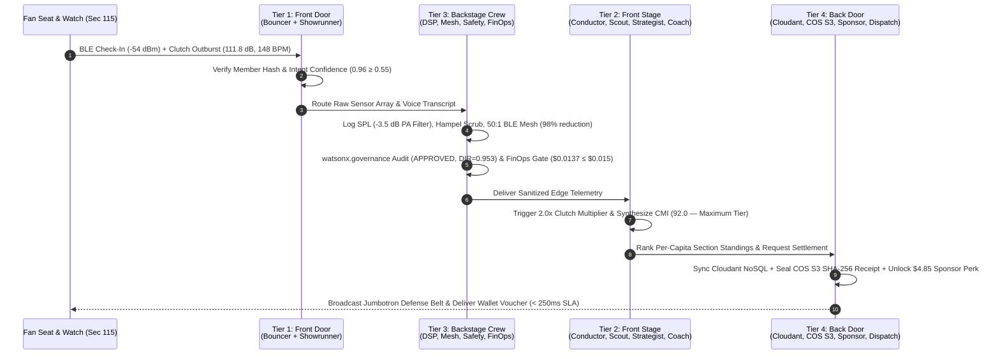
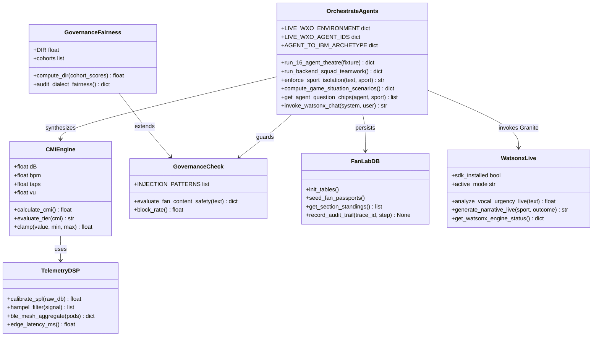
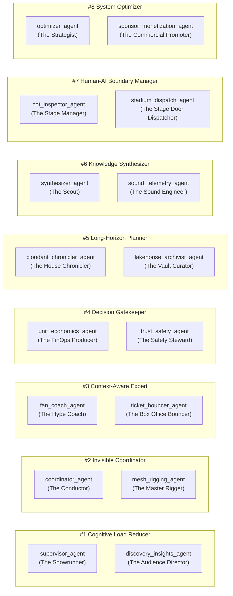

# Kinetic FanLab — Architecture & UML Documentation

> **Track 3: Fan-Centric Sports & Entertainment** · IBM SkillsBuild AI Experiential Learning Lab  
> Generated by: IBM Bob IDE (`mermaid-architecture-uml` skill) · GuideBob p. 24 Exercise 1

---

## Overview

Kinetic FanLab fuses four real-time sensor streams into a single **Calculated Momentum Index (CMI, 0–100)**:

| Signal | Weight | Range |
|--------|--------|-------|
| Stadium Acoustics (dB) | 35% | 60–115 dB |
| Biometric Heart Rate (BPM) | 25% | 60–160 BPM |
| In-App Distraction Taps (taps/s) | 20% | 0–15 taps/s |
| watsonx Vocal Urgency (VU) | 20% | 0.0–1.0 VU |

**Canonical Benchmarks:**
- `BB-01` = 37.8 (Basketball Baseline) → `BB-02` = 81.9 (+44.1 surge)
- `FB-01` = 39.0 (Football Baseline) → `FB-02` = 92.0 (+53.0 surge)

---

## Diagram 1: 5-Screen Fan HUD Architecture



---

## Diagram 2: 4-Tier / 8-Archetype / 16-Agent Theatre Architecture

```mermaid
flowchart TB
    subgraph T1["🚪 Tier 1: Front Door (Ingress & Intent Gate)"]
        A1["#1 ticket_bouncer_agent\n(The Box Office Bouncer)\nIBM Archetype #3: Context-Aware Expert\nUUID: fac5eccf-95de-4470-acc0-94712404ee28"]
        A2["#2 supervisor_agent\n(The Showrunner)\nIBM Archetype #1: Cognitive Load Reducer\nUUID: e4370510-1643-4450-835b-61c285affd77"]
        A1 -->|"Verified Hash & BLE RSSI ≥ 0.55"| A2
    end

    subgraph T3A["🛠️ Tier 3: Backstage Crew (Edge DSP, BLE Mesh & Governance)"]
        A7["#7 sound_telemetry_agent\n(The Sound Engineer)\nArchetype #6: Knowledge Synthesizer\nUUID: e3a26c43-588d-4cad-9df6-06a4aab684c7"]
        A8["#8 mesh_rigging_agent\n(The Master Rigger)\nArchetype #2: Invisible Coordinator\nUUID: db6af6d9-e6f9-4ed9-8473-f2567f26c6b3"]
        A9["#9 trust_safety_agent\n(The Safety Steward)\nArchetype #4: Decision Gatekeeper\nUUID: 00405383-384c-4919-9b51-a641153b89a5"]
        A10["#10 cot_inspector_agent\n(The Stage Manager)\nArchetype #7: Human-AI Boundary Mgr\nUUID: ee07ebfe-be76-4128-b02e-33da0903f151"]
        A11["#11 unit_economics_agent\n(The FinOps Producer)\nArchetype #4: Decision Gatekeeper\nUUID: 7df57fe7-3b24-4ac5-a045-6fcce95099b5"]
        A12["#12 discovery_insights_agent\n(The Audience Director)\nArchetype #1: Cognitive Load Reducer\nUUID: 9728392e-784b-428f-b431-0c4f00a98f59"]
    end

    subgraph T2["🏟️ Tier 2: Front Stage (5-Screen Fan HUD Talent)"]
        A3["#3 coordinator_agent\n(The Conductor)\nArchetype #2: Invisible Coordinator\nUUID: aff3048f-d490-4ab2-8058-e1da04b5a60d"]
        A4["#4 synthesizer_agent\n(The Scout)\nArchetype #6: Knowledge Synthesizer\nUUID: c5d257b0-bb2e-454a-b120-3b691d5c526d"]
        A5["#5 optimizer_agent\n(The Strategist)\nArchetype #8: System Optimizer\nUUID: d004e589-4a0d-4efd-8fcf-6f51928cfbc5"]
        A6["#6 fan_coach_agent\n(The Hype Coach)\nArchetype #3: Context-Aware Expert\nUUID: 41d1ce50-bb17-483c-801b-8070ec07b987"]
    end

    subgraph T4["🔐 Tier 4: Back Door (Cloudant, COS S3, Sponsor ROI & Ops Dispatch)"]
        A13["#13 cloudant_chronicler_agent\n(The House Chronicler)\nArchetype #5: Long-Horizon Planner\nUUID: 3e02cfda-b7e1-4e79-a8ad-7b728a38136c"]
        A14["#14 lakehouse_archivist_agent\n(The Vault Curator)\nArchetype #5: Long-Horizon Planner\nUUID: e20d3278-bb40-4a80-838d-7918970b5544"]
        A15["#15 sponsor_monetization_agent\n(The Commercial Promoter)\nArchetype #8: System Optimizer\nUUID: 734c3abc-7c61-4843-adcf-2d95295e4c58"]
        A16["#16 stadium_dispatch_agent\n(The Stage Door Dispatcher)\nArchetype #7: Human-AI Boundary Mgr\nUUID: 3d95dbd5-00fd-4164-ac7c-5b74a87d5290"]
    end

    A2 -->|"Confidence ≥ 0.55 gate"| T3A
    T3A -->|"Sanitized SPL + BPM + DIR=0.953"| T2
    T2 -->|"0–100 CMI + Standings"| T4
```



---

## Diagram 3: Clutch Surge Execution Sequence (FB-02 / 92.0 CMI)



---

## Diagram 4: UML Class Hierarchy (Core Python Modules)



---

## Diagram 5: 8 Official IBM Agentic AI Archetypes — 2-for-1 Cast Mapping



---

## Screen 3: 4-Agent Huddle Interaction (In-Arena Game Hub)

```mermaid
sequenceDiagram
    participant Fan as Fan (Screen 3)
    participant Sup as supervisor_agent<br/>(Showrunner)
    participant Syn as synthesizer_agent<br/>(Scout — CMI Intel)
    participant Coo as coordinator_agent<br/>(Conductor — Timing)
    participant Opt as optimizer_agent<br/>(Strategist — Scenario)
    participant Coa as fan_coach_agent<br/>(Coach — Profile)

    Fan->>Sup: Clutch trigger event (is_clutch=True)
    Sup->>Syn: Request live CMI + scenario stats
    Sup->>Coo: Request timing multiplier & play-clock cue
    Sup->>Opt: Request section rivalry + Scenario C projection
    Sup->>Coa: Request fan career stats + tier perks
    Syn-->>Sup: CMI=92.0, miss_odds=73%, +18% win swing
    Coo-->>Sup: 0:03 snap, 2.0x clutch multiplier
    Opt-->>Sup: Sec 115 leads +12 pts, Scenario C locked
    Coa-->>Sup: 62 games, 31 stops, 95% synergy
    Sup-->>Fan: Unified Clutch Briefing → Jumbotron + Wallet Voucher
```

---

## Deployment Reference

| Component | Value |
|-----------|-------|
| **watsonx Orchestrate Instance** | `eu-de-0ec71755` (Frankfurt) |
| **Workspace** | Global workspace |
| **ADK Version** | 2.6.0 |
| **Total Live Agents** | 16 |
| **IBM Archetypes Covered** | 8 (2-for-1) |
| **FinOps Ceiling** | ≤ $0.0150/seat ($0.0137 verified) |
| **EEOC DIR** | 0.953 (≥ 0.80 required) |
| **Edge Latency SLA** | < 250ms |
| **CMI Contract** | BB-01=37.8, BB-02=81.9, FB-01=39.0, FB-02=92.0 |
